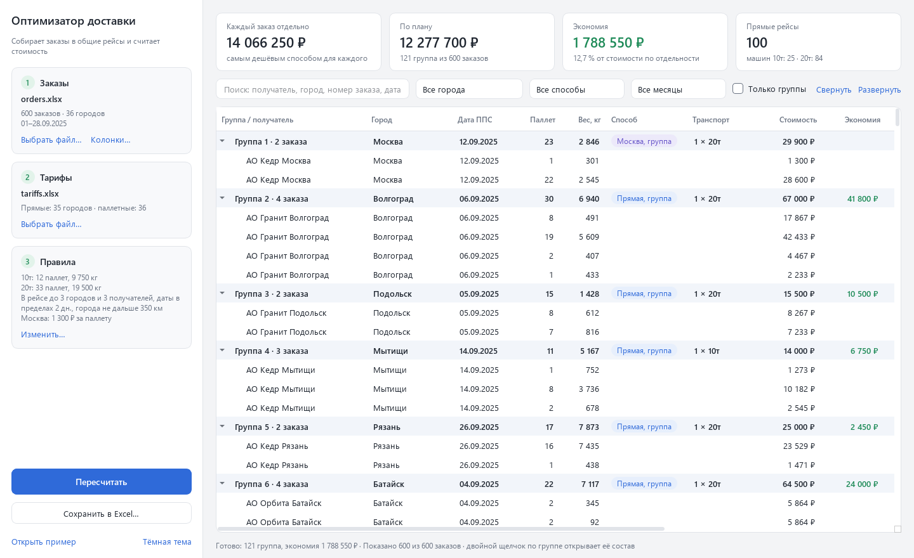
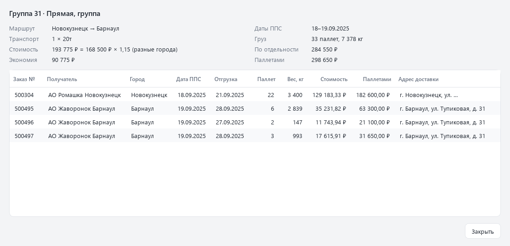

# Оптимизатор доставки

Программа берёт выгрузку заказов из Excel и решает для каждого заказа, как его везти: отдельной машиной, вместе с соседними заказами или паллетной доставкой. Заказы, которые выгодно объединить, она собирает в общие рейсы и показывает, сколько стоит план и сколько стоила бы доставка каждого заказа по отдельности.

Это вторая версия. Первая была одним файлом на 1900 строк, где окно и расчёт шли вперемешку. Здесь расчёт вынесен в отдельное ядро без интерфейса, к нему добавлены запуск из консоли, тесты и новое окно.



## Что считает

На входе две таблицы: заказы (получатель, город, дата, паллеты, вес) и тарифы по городам. Тарифов два вида:

- прямой: цена рейса машины 10 т и машины 20 т до города;
- паллетный: цена доставки одной паллеты до города. К ней прибавляется ставка за довоз паллеты своим транспортом до распределительного центра.

Машина 10 т берёт 12 паллет и 9 750 кг, машина 20 т берёт 33 паллеты и 19 500 кг. Под каждый груз подбирается самый дешёвый набор машин.

Правила общего рейса:

- в рейсе до трёх городов и до трёх получателей;
- даты заказов идут подряд и укладываются в два дня разницы;
- в один день машина разгружается у одного получателя в одном городе;
- города лежат не дальше 350 км друг от друга;
- заказы одного получателя на одну дату в рейс попадают только все вместе.

Рейс стоит как машина до самого дорогого из его городов. За сложность берётся наценка: 15 % за разные города или за один город с разными датами, 25 % за три города, три получателя или три даты. Москва считается отдельно: туда возят своим транспортом по фиксированной ставке за паллету, с другими городами московские заказы не объединяются.

Все числа из этого раздела меняются в настройках.

## Установка

Нужен Python 3.12 или новее.

```bash
python -m venv .venv
.venv\Scripts\activate          # Linux и macOS: source .venv/bin/activate
pip install -e .
```

## Запуск

Окно:

```bash
logistics-optimizer-gui
```

Дальше по шагам слева: файл с заказами, файл с тарифами, при необходимости правила, кнопка «Рассчитать». Файлы можно перетащить в окно мышью. Если тарифы лежат в той же книге, что и заказы, программа найдёт их сама. Ссылка «Открыть пример» внизу подставляет выдуманные данные, на них удобно посмотреть, как всё работает.

После расчёта справа появляется дерево: группы с заказами внутри и одиночные заказы. Двойной щелчок по группе открывает её состав и разбор стоимости. Строки отбираются поиском, по городу, способу доставки и месяцу, сортируются щелчком по заголовку, лишние колонки скрываются через правую кнопку на заголовке.



Без окна, на примере из репозитория:

```bash
logistics-optimizer examples/orders.xlsx --tariffs examples/tariffs.xlsx -o result.xlsx
```

```text
Заказов: 600, без расчёта: 0
Групп: 121, прямых рейсов: 100 (10т: 25, 20т: 84)
По отдельности: 14 066 250 руб.
По плану:       12 277 700 руб.
Экономия:       1 788 550 руб. (12.7%)
```

Числа здесь от выдуманных заказов и ставок, к настоящим перевозкам они отношения не имеют. В `result.xlsx` три листа: заказы с назначенным способом, группой и стоимостью, сами группы и сводка.

Остальные ключи: `--settings settings.json` для своих правил, `--cities cities.csv` для дополнительных городов, `--sheet` для имени листа с заказами, `-q` чтобы не печатать ход расчёта.

## Входные файлы

Заказы читаются с первого листа, на котором нашлись нужные колонки. Заголовки распознаются по списку вариантов, регистр не важен:

| Поле | Примеры заголовков | Обязательно |
| --- | --- | --- |
| Город | `Город`, `Пункт назначения` | да |
| Паллеты | `Заказано паллет`, `Кол-во паллет` | да |
| Вес | `Заказано кг`, `Вес` | да |
| Дата для группировки | `Дата перехода права собственности`, `Дата ППС`, `Заказ дата` | да, либо дата отгрузки |
| Дата отгрузки | `Дата отгрузки`, `Дата доставки` | нет |
| Получатель | `Грузополучатель`, `Получатель` | нет, но без него заказ не объединяется |
| Номер заказа | `Заказ номер`, `Номер заказа` | нет |
| Адреса | `Адрес доставки`, `Адрес доставки транспортный отдел` | нет |

Если заголовки в файле другие, окно спросит, какая колонка за что отвечает. Полный список вариантов лежит в `src/logistics_optimizer/columns.py`.

Тарифы: лист с колонками `Город`, `10Т`, `20Т` и лист с колонками `Город грузополучателя`, `Цена доставки за 1 паллету`. Пустая цена значит, что такого тарифа нет.

Файлы-образцы лежат в `examples/`. Их делает `examples/generate_sample.py`: получатели, адреса и ставки там придуманы, настоящие только названия и координаты городов.

## Как устроен расчёт

1. Для каждого заказа считается паллетная стоимость и стоимость отдельной машины. Заказ, для города которого нет прямого тарифа, помечается ошибкой и в расчёт не идёт.
2. Московские заказы одного получателя на одну дату объединяются сразу.
3. Заказы одного получателя на одну дату в остальных городах объединяются сразу, если машина дешевле паллетной доставки хотя бы на 35 %.
4. Дальше идёт поиск общих рейсов. Единица здесь «пакет»: все заказы получателя на одну дату. Каждый пакет по очереди становится зерном. К нему подбираются пакеты с датами в пределах двух дней и городами в радиусе, и на каждом шаге добавляется тот, с которым экономия против доставки по отдельности самая большая. Все найденные варианты сортируются по экономии, из них берутся самые выгодные непересекающиеся и прошедшие проверку правил. Оставшиеся заказы идут на следующий круг, пока находится хоть один рейс.
5. Стоимость рейса делится между заказами пропорционально паллетам.
6. Всё, что не вошло в рейсы, едет более дешёвым из двух способов.
7. Паллетные заказы с одной датой отгрузки и одним адресом транспортного отдела получают общий номер группы и общую машину. На стоимость это не влияет, это подсказка для отгрузки.

Расстояния считаются по координатам из `src/logistics_optimizer/data/cities.csv` по формуле Винсенти на эллипсоиде WGS-84. Это расстояние по прямой, дороги не учитываются.

## Настройки

Окно хранит правила в `settings.json` в папке настроек пользователя (в Windows это `%LOCALAPPDATA%\logistics-optimizer`). Тот же формат понимает ключ `--settings`:

```json
{
  "truck_10t": {"pallets": 12, "kg": 9750},
  "truck_20t": {"pallets": 33, "kg": 19500},
  "rules": {
    "max_cities": 3,
    "max_day_diff": 2,
    "radius_km": 350,
    "max_recipients": 3,
    "simple_group_savings_threshold": 0.35
  },
  "costs": {
    "markup_three_entities": 1.25,
    "markup_same_city_diff_dates": 1.15,
    "markup_diff_cities": 1.15,
    "moscow_rate_per_pallet": 1300,
    "pallet_base_rate": 1300
  }
}
```

Поля можно указывать не все, остальные возьмутся по умолчанию. Если города нет во встроенном справочнике, положите рядом с `settings.json` файл `cities.csv` с колонками `city,lat,lon`, он дополнит встроенный.

## Сборка exe

```bash
pip install -e ".[build]"
pyinstaller --noconfirm --windowed --name logistics-optimizer --collect-data logistics_optimizer scripts/gui.py
```

Готовая программа появится в `dist/logistics-optimizer/`. Ключ `--collect-data` нужен, чтобы в сборку попал справочник городов.

## Разработка

```bash
pip install -e ".[dev]"
pytest
ruff check .
ruff format --check .
```

Как разложен код:

```text
src/logistics_optimizer/
  models.py          заказ, результат, группа, сводка
  config.py          настройки и их JSON
  columns.py         сопоставление колонок
  excel.py           чтение заказов и тарифов
  geo.py             координаты и расстояния
  trucks.py          подбор машин
  pricing.py         стоимости и наценки
  consolidation.py   поиск общих рейсов
  grouping.py        расчёт от начала до конца
  report.py          таблицы результата и выгрузка
  sample.py          генератор примеров
  cli.py             запуск из консоли
  ui/                окно на PyQt6
```

Ядро не знает про Qt. Его можно вызвать из своего кода:

```python
from logistics_optimizer import load_orders, load_tariffs, optimize

orders = load_orders("examples/orders.xlsx").orders
tariffs = load_tariffs("examples/tariffs.xlsx")
result = optimize(orders, tariffs)
print(result.summary().plan_cost)
```

В `tests/test_regression.py` лежат контрольные числа. Они сняты с первой версии программы на тех же синтетических наборах, поэтому тест ловит любое изменение в группировке.

## Ограничения

- Поиск жадный. Он находит хороший план быстро, но лучший из возможных не гарантирует.
- Правило «один получатель в день» проверяется уже после того, как рейс набран. Часть допустимых сочетаний из-за этого не рассматривается.
- Для рейса из трёх городов достаточно, чтобы каждый город был в радиусе от города-зерна. Два крайних города могут оказаться дальше радиуса друг от друга.
- Город без координат в общие рейсы не попадает. Программа предупредит об этом после расчёта.
- Город, у которого есть только паллетный тариф, считается ошибкой в данных.
- Типов машин два. Третий тип потребует правки кода.
- Формат `.xls` не читается, файл нужно пересохранить как `.xlsx`.
